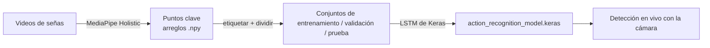

# LETW

**Entrena un modelo de IA que reconoce señas de LESCO (Lengua de Señas Costarricense) a partir de video.**

LETW convierte tus propios videos de señas en puntos clave (keypoints) del cuerpo, las manos y la cara con MediaPipe. Luego entrena una red LSTM de Keras con esos puntos y reconoce las señas en vivo desde tu cámara web.

[](README.md)
[](pyproject.toml)
[](https://keras.io)
[](LICENSE)

▶️ **Video tutorial:** https://youtu.be/BP-zg0obO7w

---

## Contenido

- [Cómo funciona](#cómo-funciona)
- [Inicio rápido](#inicio-rápido)
- [Flujo de trabajo](#flujo-de-trabajo)
- [Configuración](#configuración)
- [Otros backends de Keras](#otros-backends-de-keras)
- [Estructura del proyecto](#estructura-del-proyecto)
- [Contribuir](#contribuir)
- [Créditos](#créditos)

---

## Cómo funciona



1. Grabas cada seña varias veces.
2. MediaPipe extrae los puntos clave de cada cuadro (frame).
3. Cada video se convierte en una secuencia de cuadros. La LSTM aprende a distinguir las secuencias.
4. El modelo entrenado corre sobre la imagen de tu cámara en tiempo real.

---

## Inicio rápido

> [!IMPORTANT]
> Usa la rama `main`. `Dev` es para desarrollo activo y puede tener errores.

**Requisitos:** [`uv`](https://docs.astral.sh/uv/getting-started/installation/) y una cámara web para la detección en vivo. `uv` instala la versión correcta de Python (3.12) por ti.

```bash
git clone https://github.com/Tonysk8cr/LETW.git
cd LETW
uv sync                        # crea .venv e instala todo, TensorFlow incluido
uv run ./Model/Test/App.py     # inicia la aplicación
```

La aplicación es un menú de consola.

---

## Flujo de trabajo

Usa las opciones del menú en este orden:

| # | Opción del menú | Qué hace |
|---|---|---|
| **1** | Crear directorios necesarios | Crea `MP_Data/`, `Test_Videos/` y `Unedited_videos/` dentro de `Model/Test/`, más una subcarpeta por seña. |
| 2 | Editar y recortar videos | *Aún no está implementada.* No hace nada. |
| **3** | Procesar y extraer datos de video | Extrae los puntos clave de tus videos a `MP_Data/`. Primero pide la confianza de MediaPipe (por defecto `0.7`). |
| 4 | Procesar videos en lote | Reproduce los videos con los puntos detectados para que los revises. **No guarda datos.** |
| **5** | Label Data | Etiqueta las secuencias y las divide 70 / 15 / 15 en entrenamiento, validación y prueba. |
| **6** | Train LSTM | Entrena el modelo. Guarda `action_recognition_model.keras` y los registros de TensorBoard en `Logs/`. |
| **7** | Detección en tiempo real | Abre la cámara y muestra la seña reconocida en vivo. |
| 8 | Salir | Cierra la aplicación. |

### Paso 1: Agrega tus videos

Después de la opción **1**, coloca tus videos en la carpeta de cada seña. Numéralos desde 1:

```text
Model/Test/Test_Videos/
├── HOLA/
│   ├── HOLA1.mp4
│   ├── HOLA2.mp4
│   └── …
└── GRACIAS/
    ├── GRACIAS1.mp4
    └── …
```

> [!TIP]
> Con la opción 4 puedes revisar un video antes de extraerlo. Si faltan puntos, vuelve a grabar el video o baja la confianza.

### Ver el progreso del entrenamiento

```bash
uv run tensorboard --logdir Logs
```

El modelo y `Logs/` se guardan en la carpeta desde donde ejecutaste la aplicación. Git ignora ambos.

---

## Configuración

Toda la configuración está en la clase `Context` de [`Model/Test/App.py`](Model/Test/App.py):

| Ajuste | Valor por defecto | Significado |
|---|---|---|
| `DEFAULT_SIGNS` | `HOLA`, `ADIOS`, `GRACIAS`, … (12 señas) | Las señas que aprende el modelo. Los nombres de las carpetas salen de esta lista. |
| `DEFAULT_REPETITIONS` | `100` | Secuencias grabadas por seña. |
| `DEFAULT_FRAMES` | `30` | Cuadros por secuencia. |
| `DEFAULT_CONFIDENCE` | `0.7` | Confianza de detección de MediaPipe. La aplicación la pregunta antes de extraer y de detectar. |

> [!WARNING]
> Define tus señas **antes** de usar la opción 1. Si cambias la lista después, repite las opciones 1, 3, 5 y 6.

---

## Otros backends de Keras

TensorFlow es el backend por defecto. Para usar JAX o PyTorch, ejecuta:

```bash
# JAX
uv run --group jax env KERAS_BACKEND=jax python ./Model/Test/App.py

# PyTorch
uv run --group torch env KERAS_BACKEND=torch python ./Model/Test/App.py
```

---

## Estructura del proyecto

```text
Model/Test/
├── App.py                       # punto de entrada: menú y configuración
├── CreateProjectDirsCommand.py  # opción 1: creación de carpetas
├── MediapipeHolistic.py         # extracción de puntos con MediaPipe
├── DataExtraction.py            # opción 3: videos → .npy
├── VideoBatchProcessor.py       # opciones 3–4: recorre los videos
├── DataLabelling.py             # opción 5: etiquetas y división de datos
├── TrainingLSTM.py              # opción 6: modelo LSTM y entrenamiento
├── RealtimePrediction.py        # opción 7: detección con la cámara
├── VideoEditor.py               # opción 2 (en desarrollo)
├── Strings.py                   # todos los textos de la consola
└── Utilities.py                 # registros (logging) y funciones compartidas
```

---

## Contribuir

LETW es código abierto bajo la [Licencia MIT](LICENSE). Úsalo libremente, y por favor no le cobres a otros por él. El proyecto existe para ayudar a quienes más lo necesitan.

Para contribuir:

1. Crea tu rama a partir de `Dev` y abre tu pull request hacia `Dev`.
2. Instala las herramientas de desarrollo y los hooks de lint:
   ```bash
   uv sync --group dev
   uv run pre-commit install
   ```
3. Ruff formatea y revisa tu código en cada commit.

### Desarrollado por

- [@Tonysk8cr](https://github.com/Tonysk8cr)
- [@eariassoto](https://github.com/eariassoto)

## Créditos

LETW está basado en [ActionDetectionforSignLanguage](https://github.com/nicknochnack/ActionDetectionforSignLanguage) de [@nicknochnack](https://github.com/nicknochnack). Partes de su código se adaptaron y ampliaron para LESCO.
