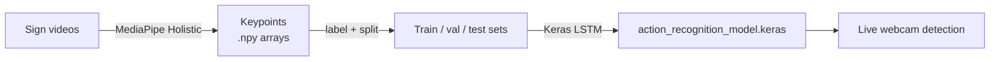

# LETW

**Train an AI model that recognizes LESCO (Costa Rican Sign Language) signs from video.**

LETW turns your own sign videos into body, hand and face keypoints with MediaPipe. It trains a Keras LSTM on those keypoints and recognizes signs live from your webcam.

[](README.es.md)
[](pyproject.toml)
[](https://keras.io)
[](LICENSE)

▶️ **Video tutorial:** https://youtu.be/BP-zg0obO7w

---

## Contents

- [How it works](#how-it-works)
- [Quick start](#quick-start)
- [Workflow](#workflow)
- [Configuration](#configuration)
- [Other Keras backends](#other-keras-backends)
- [Project structure](#project-structure)
- [Contributing](#contributing)
- [Credits](#credits)

---

## How it works



1. You record each sign several times.
2. MediaPipe extracts keypoints from every frame.
3. Each video becomes a sequence of frames. The LSTM learns to tell the sequences apart.
4. The trained model runs on your webcam feed in real time.

---

## Quick start

> [!IMPORTANT]
> Use the `main` branch. `Dev` is for active development and may be broken.

**Requirements:** [`uv`](https://docs.astral.sh/uv/getting-started/installation/) and a webcam for live detection. `uv` installs the correct Python version (3.12) for you.

```bash
git clone https://github.com/Tonysk8cr/LETW.git
cd LETW
uv sync                        # creates .venv and installs everything, TensorFlow included
uv run ./Model/Test/App.py     # starts the app
```

The app is a console menu. Its prompts are in Spanish.

---

## Workflow

Run the menu options in this order:

| # | Menu option | What it does |
|---|---|---|
| **1** | Crear directorios necesarios | Creates `MP_Data/`, `Test_Videos/` and `Unedited_videos/` inside `Model/Test/`, plus one subfolder per sign. |
| 2 | Editar y recortar videos | *Not implemented yet.* Does nothing. |
| **3** | Procesar y extraer datos de video | Extracts keypoints from your videos into `MP_Data/`. Asks for the MediaPipe confidence first (default `0.7`). |
| 4 | Procesar videos en lote | Plays videos back with the detected landmarks so you can check them. **Saves no data.** |
| **5** | Label Data | Labels the keypoint sequences and splits them 70 / 15 / 15 into train, validation and test sets. |
| **6** | Train LSTM | Trains the model. Saves `action_recognition_model.keras` and TensorBoard logs in `Logs/`. |
| **7** | Detección en tiempo real | Opens the webcam and shows the recognized sign live. |
| 8 | Salir | Exits. |

### Step 1: Add your videos

After option **1**, put your videos in the sign's folder. Number them from 1 up:

```text
Model/Test/Test_Videos/
├── HOLA/
│   ├── HOLA1.mp4
│   ├── HOLA2.mp4
│   └── …
└── GRACIAS/
    ├── GRACIAS1.mp4
    └── …
```

> [!TIP]
> Option 4 lets you check a video before you extract it. If landmarks are missing, re-record the video or lower the confidence.

### Watch training progress

```bash
uv run tensorboard --logdir Logs
```

The model file and `Logs/` are saved in the folder you ran the app from. Git ignores both.

---

## Configuration

All settings live in the `Context` class in [`Model/Test/App.py`](Model/Test/App.py):

| Setting | Default | Meaning |
|---|---|---|
| `DEFAULT_SIGNS` | `HOLA`, `ADIOS`, `GRACIAS`, … (12 signs) | The signs the model learns. Folder names come from this list. |
| `DEFAULT_REPETITIONS` | `100` | Recorded sequences per sign. |
| `DEFAULT_FRAMES` | `30` | Frames per sequence. |
| `DEFAULT_CONFIDENCE` | `0.7` | MediaPipe detection confidence. The app asks before extraction and detection. |

> [!WARNING]
> Set your signs **before** you run option 1. If you change the list later, run options 1, 3, 5 and 6 again.

---

## Other Keras backends

TensorFlow is the default backend. To use JAX or PyTorch instead, run:

```bash
# JAX
uv run --group jax env KERAS_BACKEND=jax python ./Model/Test/App.py

# PyTorch
uv run --group torch env KERAS_BACKEND=torch python ./Model/Test/App.py
```

---

## Project structure

```text
Model/Test/
├── App.py                       # entry point: menu and configuration
├── CreateProjectDirsCommand.py  # option 1: folder setup
├── MediapipeHolistic.py         # MediaPipe keypoint extraction
├── DataExtraction.py            # option 3: videos → .npy
├── VideoBatchProcessor.py       # options 3–4: loops over videos
├── DataLabelling.py             # option 5: labels and data split
├── TrainingLSTM.py              # option 6: LSTM model and training
├── RealtimePrediction.py        # option 7: webcam detection
├── VideoEditor.py               # option 2 (work in progress)
├── Strings.py                   # all console text
└── Utilities.py                 # logging and shared helpers
```

---

## Contributing

LETW is open source under the [MIT License](LICENSE). Use it freely, and please don't charge others for it. The project exists to help the people who need it most.

To contribute:

1. Branch off `Dev` and open your pull request against `Dev`.
2. Install the dev tools and the lint hooks:
   ```bash
   uv sync --group dev
   uv run pre-commit install
   ```
3. Ruff formats and lints your code on every commit.

### Developed by

- [@Tonysk8cr](https://github.com/Tonysk8cr)
- [@eariassoto](https://github.com/eariassoto)

## Credits

LETW is based on [ActionDetectionforSignLanguage](https://github.com/nicknochnack/ActionDetectionforSignLanguage) by [@nicknochnack](https://github.com/nicknochnack). Parts of its code were adapted and extended for LESCO.
